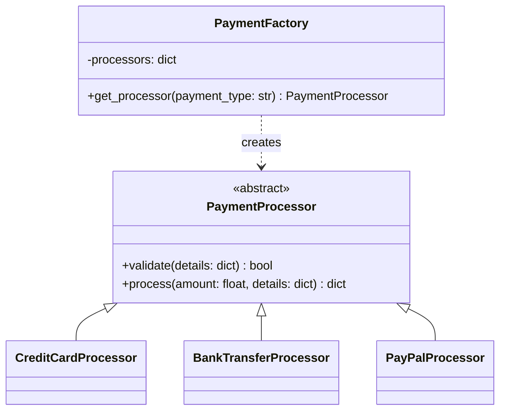
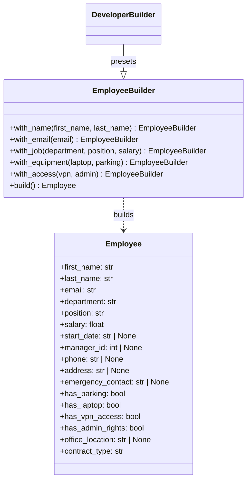
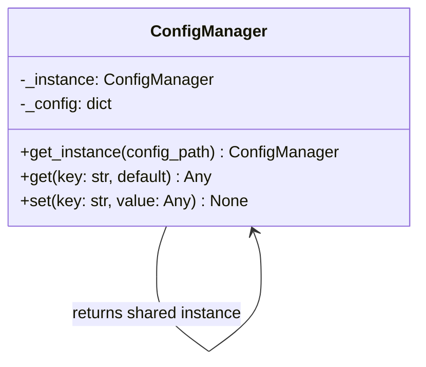

# Creational pattern refactors

The diagrams below define the class relationships before the implementation in [`patterns.py`](patterns.py).

## Payment factory



The dictionary-backed `PaymentFactory` is the registry-style factory requested in the exercise. In GoF terminology, it is closer to a Simple Factory than the subclass-overridden Factory Method pattern.

## Employee builder



## Configuration singleton



## Usage

```python
from design_patterns.patterns import (
    ConfigManager,
    DeveloperBuilder,
    EmployeeBuilder,
    PaymentFactory,
)

processor = PaymentFactory().get_processor("credit_card")
payment = processor.process(
    100.0,
    {"card_number": "1234567890123456", "cvv": "123"},
)

employee = (
    EmployeeBuilder()
    .with_name("John", "Doe")
    .with_email("john.doe@company.com")
    .with_job("Engineering", "Senior Developer", 75000)
    .with_equipment(laptop=True, parking=False)
    .with_access(vpn=True, admin=True)
    .build()
)
developer = DeveloperBuilder("John", "Doe", "john.doe@company.com").build()

config = ConfigManager.get_instance("config.json")
db_host = config.get("database.host")
```

`ConfigManager` loads the file on its first construction. Later calls return the same object, so updates made with `set` (or through a mutable value returned by `get`) are visible to every caller in the process. The first config path used for the singleton is the one that remains active.
